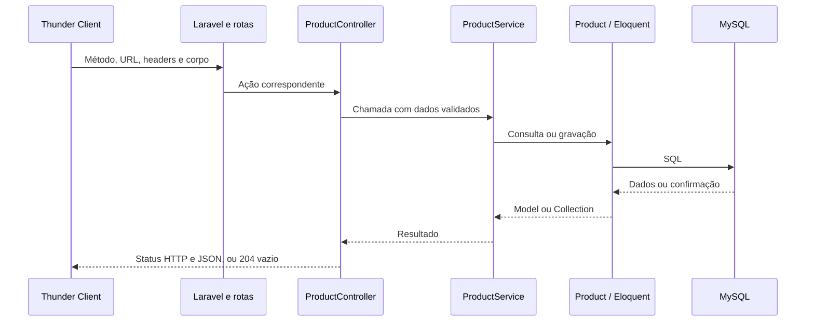

# Etapa 6 — CRUD básico de produtos

Parte de produtos concluída em 28/10/2026. Depois, o usuário autorizou concluir os CRUDs do catálogo juntos e explicar um deles com todas as requisições e respostas. Categorias, plataformas e gêneros também estão implementados; veja [crud-catalog.md](crud-catalog.md). Resources e FormRequests ainda ficam para a etapa 7.

## Conceitos antes do código

CRUD resume quatro operações: **Create** (criar), **Read** (consultar), **Update** (atualizar) e **Delete** (excluir). Na API de produtos, a consulta tem duas ações: listar todos e consultar um pelo ID.

O caminho de uma chamada é: **Thunder Client → rota → Controller → Service → Model → MySQL**. A resposta volta em JSON, um formato de dados que o Vue também poderá consumir.

- **Rota:** associa um método e uma URL a uma ação do Controller.
- **Controller:** recebe a requisição, valida os campos e devolve a resposta HTTP.
- **Service:** executa as consultas e gravações do produto, incluindo seus relacionamentos.
- **Model:** usa o Eloquent para trabalhar com as tabelas já criadas.

Poderíamos colocar as consultas no Controller. Usamos um Service porque ele faz parte da etapa combinada e mantém a gravação das associações no mesmo lugar, permitindo reutilizar essa operação. Não criamos repositórios, classes base ou interfaces extras.

## Arquivos envolvidos

| Arquivo | Responsabilidade |
| --- | --- |
| `bootstrap/app.php` | Carrega `routes/api.php`, com o prefixo `/api`. |
| `routes/api.php` | Registra as cinco ações de cada cadastro por `Route::apiResources`. |
| `app/Http/Controllers/ProductController.php` | Recebe requisições, valida entradas e monta respostas. |
| `app/Services/ProductService.php` | Consulta, cria, atualiza e desativa produtos. |
| `tests/Feature/ProductApiTest.php` | Testa o comportamento da API e uma falha durante a gravação. |

Não foi executado `install:api`, pois esse comando também instala Sanctum. A autenticação continua reservada à etapa 8. Por enquanto as rotas não exigem login nem perfil; são a API em desenvolvimento. Não há Resources ou FormRequests novos: eles pertencem à etapa 7.

`Route::apiResource()` registra as rotas. Os Resources da etapa 7 serão classes para organizar os dados da resposta JSON; são recursos diferentes do framework, apesar dos nomes semelhantes.

## Como ler o Controller

O construtor recebe `ProductService`. O Laravel cria essa dependência automaticamente. Não é necessário montar o Service com `new` em cada método nem registrar uma configuração adicional.

`index()` lista todos. `store()` cadastra. `show()` consulta um produto. `update()` altera os campos enviados. `destroy()` desativa o produto.

Nos métodos com `Product $product`, o Laravel procura o registro pelo parâmetro `{product}` da URL. Isso é o **route model binding**: se o ID não existir, ele responde 404 antes de executar a ação.

`$request->validate(...)` devolve somente os campos validados. Por exemplo, `exists:platforms,id` exige uma plataforma existente, e `category_ids.*` verifica cada elemento da lista. `distinct` impede repetir o mesmo ID na lista. Erros de validação retornam 422 quando a requisição pede JSON.

Na atualização, `sometimes` permite omitir um campo; `required` impede que um campo obrigatório seja enviado vazio. Nesta primeira versão, PUT e PATCH aceitam atualização parcial. As regras repetidas de cadastro e edição serão organizadas em FormRequests na etapa 7.

## Como ler o Service

- `getAll()` consulta os cadastros ordenados pelo ID e carrega plataforma, categorias e gêneros com `with()`.
- `getOne()` carrega esses relacionamentos com `load()` para um produto encontrado.
- `create()` separa `category_ids` e `genre_ids`, salva o produto e grava as tabelas de ligação.
- `update()` muda somente os dados enviados. Uma lista de associações enviada substitui a lista anterior; uma lista omitida é preservada.
- `delete()` define `is_active` como falso, mantendo a linha no banco.

`DB::transaction()` mantém a gravação do produto e dos vínculos na mesma operação. Se uma associação falhar, a criação ou atualização não deve ficar pela metade.

No CRUD usamos `sync()` porque a lista enviada pelo administrador representa as associações desejadas naquele momento. Isso difere do `syncWithoutDetaching()` dos seeders, que apenas acrescenta os vínculos iniciais sem apagar associações existentes.

`refresh()` lê novamente as colunas do banco após a gravação, incluindo padrões como `is_active = true`. Assim, a resposta do cadastro também contém esse valor quando o cliente não o enviou.

## Comportamento da desativação

Excluir fisicamente com `delete()` apagaria o registro e poderia afetar referências em carrinhos e pedidos. A modelagem já previa retirar produtos de oferta com `is_active`, então usamos essa coluna, sem acrescentar `deleted_at` ou novas migrations.

Esta API básica lista **ativos e inativos** para conferir os cadastros administrativos. Depois de um DELETE, consultar o mesmo ID ainda responde 200, com `is_active: false`. É possível reativá-lo enviando `is_active: true` no PATCH. A listagem pública do catálogo e suas permissões serão tratadas nas etapas correspondentes.

## Testar no Thunder Client

Com os serviços ativos, crie as requisições abaixo. Configure os headers:

| Header | Valor | Para que serve |
| --- | --- | --- |
| `Accept` | `application/json` | Solicita respostas e erros em JSON. |
| `Content-Type` | `application/json` | Informa o formato do corpo de POST, PUT e PATCH. |

Use a aba **Body → JSON** para enviar os corpos. Não é necessário token nesta etapa.

| Método | URL | Ação | Status esperado |
| --- | --- | --- | --- |
| GET | `http://localhost:8000/api/products` | Listar cadastros. | 200 |
| GET | `http://localhost:8000/api/products/1` | Consultar o ID 1. | 200, se existir. |
| POST | `http://localhost:8000/api/products` | Cadastrar. | 201 |
| PATCH ou PUT | `http://localhost:8000/api/products/ID` | Atualizar o ID informado. | 200 |
| DELETE | `http://localhost:8000/api/products/ID` | Desativar. | 204, sem corpo. |

### 1. Listar e identificar os IDs

Comece pelo GET de listagem. Na última verificação havia 7 produtos. A resposta é uma lista JSON, sem um campo externo `data`. Cada produto inclui `platform`, `categories` e `genres`, com seus IDs. Copie os IDs existentes para testar a criação.

Os Models ainda são devolvidos diretamente em JSON, incluindo datas e dados de ligação `pivot`. A organização da resposta em Resources virá na etapa 7. Não há paginação ou filtros nesta parte inicial.

### 2. Cadastrar um produto

Os IDs abaixo são exemplos; confira os existentes no GET. O preço usa ponto decimal, e a imagem é o caminho da ilustração já presente no projeto, sem upload de arquivo.

```json
{
  "name": "Jogo de Teste",
  "description": "Jogo físico para testar o cadastro pelo Thunder Client.",
  "platform_id": 1,
  "price": "199.90",
  "image_path": "images/product-placeholder.svg",
  "stock": 5,
  "category_ids": [1, 3],
  "genre_ids": [1, 3]
}
```

`platform_id` é a única plataforma do produto. `category_ids` deve ter pelo menos uma categoria. `genre_ids` é opcional e pode ser `[]`. Se `is_active` não for enviado, o banco utiliza verdadeiro.

Guarde o `id` retornado com status 201 e use-o nas próximas requisições. Um POST sempre cria um novo cadastro; não tem a busca prévia por nome que usamos nos seeders. Repetir o mesmo POST pode criar outro produto com o mesmo nome e plataforma.

### 3. Consultar e atualizar o produto criado

Faça GET para `/api/products/ID`, substituindo ID pelo valor retornado no POST.

Depois envie um PATCH para a mesma URL:

```json
{
  "price": "179.90",
  "stock": 3
}
```

Somente preço e estoque mudam. Nome, plataforma, categorias e gêneros permanecem.

Para alterar associações, envie as listas completas desejadas. `"genre_ids": []` retira todos os gêneros; omitir esse campo os mantém. `"category_ids": []` é rejeitado porque o produto precisa de pelo menos uma categoria.

### 4. Desativar e conferir

Envie DELETE para o ID de teste. A resposta 204 é vazia, o que significa sucesso. Consulte o mesmo ID com GET e confira `is_active: false`.

O produto permanece salvo e aparece nesta listagem administrativa inicial. Se quiser reativá-lo, envie PATCH com `{"is_active": true}`.

### 5. Conferir os erros

- GET para `/api/products/999999`, caso o ID não exista: 404.
- POST com `{}`: 422 e os campos obrigatórios em `errors`.
- Preço negativo, mais de duas casas decimais ou maior que `99999999.99`: 422.
- Estoque negativo ou maior que `4294967295`: 422.
- Plataforma, categoria ou gênero inexistente: 422.
- Categoria vazia ou IDs repetidos nas listas: 422.

As mensagens padrão de validação podem estar em inglês porque ainda não adicionamos traduções do Laravel. O código e o guia têm comentários e explicações em português.

## Percurso completo: onde cada requisição começa e termina

### Entrada e saída comuns

1. Você escolhe método, URL, headers e, quando necessário, um corpo em **Body → JSON** no Thunder Client.
2. Ao clicar em Send, a requisição chega à porta 8000 do computador, publicada pelo Docker para o servidor PHP do contêiner.
3. `public/index.php` carrega o autoload do Composer e `bootstrap/app.php`, captura a requisição e a entrega ao Laravel.
4. O Laravel passa a requisição pelos middlewares aplicáveis e encontra a ação registrada em `routes/api.php` pelo método e pela URL. Essas rotas recebem o prefixo `/api`.
5. O Controller recebe a requisição. Nos caminhos com ID, o Laravel resolve `Product $product` antes de executar a ação: um ID inexistente já resulta em 404.
6. Em cadastro ou atualização, o Controller valida a entrada. Se ela for inválida, o fluxo para com 422; o Service não é chamado.
7. Se estiver tudo correto, o Controller chama o Service. O Service utiliza o Model e seus relacionamentos; o Eloquent monta as consultas SQL para o MySQL.
8. O banco devolve os resultados. O Eloquent os representa como Models ou Collection. Os casts do `Product` apresentam preço como texto decimal, estoque como inteiro e ativo como booleano.
9. O Service retorna ao Controller. `response()->json(...)` serializa os dados em JSON e define o status. Para DELETE, `noContent()` envia 204 sem JSON.
10. A resposta HTTP volta pela porta publicada e é exibida na aba Response do Thunder Client. O ciclo terminou; uma nova consulta será uma nova requisição.



O diagrama representa o caminho de sucesso. Erros de ID ou validação interrompem esse caminho antes da operação. Uma falha durante a gravação das associações provoca rollback da transação.

### GET de listagem

Requisição, sem corpo:

```http
GET http://localhost:8000/api/products
Accept: application/json
```

`routes/api.php` seleciona `ProductController::index()`. Ele chama `ProductService::getAll()`. O Service executa `Product::with(['platform', 'categories', 'genres'])->orderBy('id')->get()`.

O Eloquent consulta os produtos e carrega os relacionamentos usando `platform_id`, `category_product` e `genre_product`. A Collection volta ao Controller, que responde **200 OK**, com uma lista JSON.

Trecho reduzido da lista, mostrando alguns campos de dois produtos; a resposta real inclui todos os produtos e seus outros campos:

```json
[
  {"id": 1, "name": "Elden Ring", "price": "299.90", "stock": 8},
  {"id": 2, "name": "Elden Ring", "price": "279.90", "stock": 6}
]
```

Não há alteração no banco. Esta listagem administrativa inicial também inclui produtos desativados.

### GET de um produto

Requisição, sem corpo:

```http
GET http://localhost:8000/api/products/1
Accept: application/json
```

O parâmetro `{product}` recebe 1. O Laravel procura `products.id = 1` e entrega o Model para `ProductController::show()`. O Controller chama `ProductService::getOne($product)`, que carrega plataforma, categorias e gêneros com `load()`.

O Controller responde **200 OK**, com um objeto JSON. Para ver o que a resposta contém, este exemplo mantém os campos do produto e resume os campos internos dos relacionamentos; a API também envia datas e informações `pivot` das associações:

```json
{
  "id": 1,
  "platform_id": 1,
  "name": "Elden Ring",
  "description": "Jogo físico de ação e RPG para PlayStation 5.",
  "price": "299.90",
  "image_path": "images/product-placeholder.svg",
  "stock": 8,
  "is_active": true,
  "platform": {"id": 1, "name": "PlayStation 5"},
  "categories": [{"id": 1, "name": "Jogos"}, {"id": 3, "name": "Destaques"}],
  "genres": [{"id": 1, "name": "Ação"}, {"id": 3, "name": "RPG"}]
}
```

Se o ID não existir, a resposta é **404 Not Found**, em vez de um produto. Com `Accept: application/json`, o erro vem em JSON com `message`; o texto e os detalhes de debug podem variar conforme a configuração local. O Service não executa a consulta de relacionamentos nesse caso.

### POST de cadastro

Método e endereço:

```http
POST http://localhost:8000/api/products
Accept: application/json
Content-Type: application/json
```

Corpo em Body → JSON:

```json
{
  "name": "Jogo de Teste",
  "description": "Jogo físico cadastrado pelo Thunder Client.",
  "platform_id": 1,
  "price": "199.90",
  "image_path": "images/product-placeholder.svg",
  "stock": 5,
  "category_ids": [1],
  "genre_ids": []
}
```

A rota seleciona `ProductController::store()`. Ele valida o corpo, incluindo a existência da plataforma e das categorias. Depois chama `ProductService::create($data)` com os campos validados.

O Service abre a transação, separa as duas listas de IDs, salva as colunas em `products`, grava os vínculos em `category_product` e `genre_product` e lê o produto com os relacionamentos. Se tudo der certo, a transação é confirmada. Se uma gravação falhar, ela é desfeita junto com as outras dessa operação.

O Controller responde **201 Created** com o objeto criado. Exemplo resumido, usando ID 8 apenas como ilustração:

```json
{
  "id": 8,
  "name": "Jogo de Teste",
  "platform_id": 1,
  "price": "199.90",
  "stock": 5,
  "is_active": true,
  "categories": [{"id": 1, "name": "Jogos"}],
  "genres": []
}
```

A resposta real também inclui descrição, caminho da imagem, datas, plataforma e campos das associações. O ID é gerado pelo banco. Guarde o valor recebido e use-o nas próximas chamadas; ele não é garantidamente 8.

### PATCH ou PUT de atualização

Método e endereço, substituindo 8 pelo ID criado:

```http
PATCH http://localhost:8000/api/products/8
Accept: application/json
Content-Type: application/json
```

Corpo:

```json
{
  "price": "179.90",
  "stock": 3
}
```

O Laravel encontra o Model pelo ID. A rota chama `ProductController::update()`, que valida os campos enviados e chama `ProductService::update($product, $data)`.

O Service abre uma transação e executa a atualização. Como nenhuma lista foi enviada, categorias e gêneros são preservados. Se `category_ids` ou `genre_ids` forem enviados, `sync()` passa a usar exatamente a lista correspondente. Depois o Service recarrega o registro e o devolve ao Controller.

A resposta é **200 OK**, com o objeto atualizado. Trecho resumido:

```json
{
  "id": 8,
  "name": "Jogo de Teste",
  "price": "179.90",
  "stock": 3,
  "is_active": true
}
```

Os demais campos e relacionamentos também vêm na resposta. Nesta implementação inicial, PUT e PATCH apontam para a mesma ação e aceitam campos parciais. Atualizar o estoque no cadastro é diferente do fluxo de pagamento: nenhuma compra é criada por essa chamada.

### DELETE de desativação

Requisição, sem corpo:

```http
DELETE http://localhost:8000/api/products/8
Accept: application/json
```

O Laravel encontra o Model, a rota chama `ProductController::destroy()` e ele chama `ProductService::delete($product)`. O Service grava `is_active = false`; não executa uma exclusão física.

O Controller responde **204 No Content**. A área de resposta vazia é o resultado esperado: não existe JSON nessa resposta.

Um novo GET para o mesmo ID responde 200. Trecho resumido:

```json
{
  "id": 8,
  "name": "Jogo de Teste",
  "price": "179.90",
  "stock": 3,
  "is_active": false
}
```

Esse GET é outra chamada e demonstra que a linha continua no banco. Para reativar, faça PATCH com `{"is_active": true}`. Um DELETE de ID inexistente retorna 404.

### Onde o caminho para quando há erro

- **Hostname inválido:** com `www.localhost`, o erro de resolução pode acontecer no Thunder Client antes de alcançar o Laravel. Use `localhost` ou `127.0.0.1`.
- **Servidor inacessível:** se o Docker ou PHP estiver parado, o cliente não consegue obter uma resposta HTTP da aplicação.
- **ID inexistente:** o Laravel retorna 404 durante a busca do Model para a rota, antes da ação do Controller.
- **Entrada inválida:** a validação do Controller retorna 422, antes de chamar o Service. Por exemplo, enviar `stock: -1` não grava estoque negativo.
- **Regra de exclusão de classificação:** nos outros três CRUDs, o Service pode retornar um erro de validação por existir produto associado. O Laravel o apresenta em JSON com status 422.
- **Falha durante a transação de produtos:** os dados da operação são desfeitos; não fica um produto parcialmente cadastrado. O teste provoca uma falha de chave estrangeira diretamente no Service para verificar essa garantia.

Exemplo reduzido de erro 422 ao enviar estoque negativo:

```json
{
  "message": "The stock field must be at least 0.",
  "errors": {
    "stock": ["The stock field must be at least 0."]
  }
}
```

A mensagem segue a tradução disponível no Laravel; o campo `errors.stock` informa onde corrigir o corpo. O header `Accept: application/json` garante que o cliente solicite o erro em JSON.

## Verificação executada

- [x] Sintaxe PHP verificada no Controller, Service e teste novos.
- [x] Pint passou nos cinco arquivos PHP desta parte.
- [x] Suíte atual com **20 testes e 336 asserções** passou em SQLite em memória, incluindo os outros CRUDs do catálogo.
- [x] Listagem, consulta, criação, criação sem gênero, atualização parcial e substituição de associações verificadas.
- [x] Desativação, reativação e preservação de vínculos verificadas.
- [x] Entradas inválidas e IDs inexistentes verificadas.
- [x] Falha de chave estrangeira no Service desfez toda a criação, inclusive as associações já gravadas.
- [x] `route:list --path=api` mostrou as cinco rotas de produtos.
- [x] Pelo endereço local, GET de listagem retornou 200 com 7 produtos; ID inexistente retornou 404; POST vazio retornou 422.
- [x] As verificações HTTP no MySQL foram de leitura ou de entrada rejeitada; os cadastros de demonstração não foram alterados por elas.

O roteiro manual do Thunder Client acima fica para o estudante repetir. A ampliação posterior concluiu os quatro CRUDs do catálogo e a suíte passou com 20 testes e 336 asserções. O resultado completo está em `docs/crud-catalog.md`.

Referências: [rotas no Laravel 12](https://laravel.com/docs/12.x/routing), [Controllers e apiResource](https://laravel.com/docs/12.x/controllers) e [validação](https://laravel.com/docs/12.x/validation).
