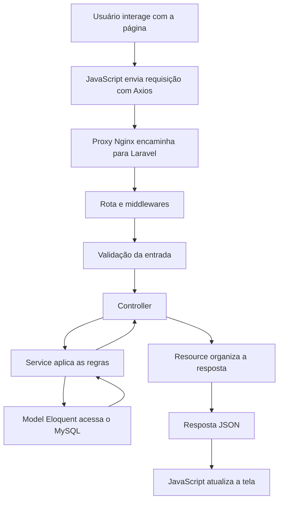

# Explicação do projeto TicoGames: frontend, backend, PHP e POO

O **TicoGames é uma loja de demonstração de jogos, consoles e acessórios**. Ela permite consultar produtos, criar uma conta, manter um carrinho, cadastrar endereços, criar pedidos e simular pagamentos. O administrador também gerencia o catálogo e acompanha os pedidos.

A ideia mais importante para compreender o projeto é esta: **o frontend apresenta a loja e recebe as ações do usuário; o backend valida essas ações, aplica as regras e grava os dados no banco**.

Esta explicação acompanha esse caminho e o relaciona aos fundamentos de PHP e POO que podem aparecer na avaliação.

---

O projeto está dividido em quatro partes principais:

| Parte | Tecnologia | Responsabilidade |
|---|---|---|
| Frontend | HTML, CSS, Bootstrap e JavaScript | Telas e interação com o usuário |
| Comunicação | Axios e HTTP | Enviar requisições e receber respostas |
| Backend | Laravel 12 e PHP | Autenticação, validação e regras da loja |
| Banco | MySQL 8.4 | Persistir contas, produtos, carrinhos e pedidos |

Nos containers, o PHP está configurado na versão 8.4.

O caminho de uma operação pode ser representado assim:



Por exemplo, clicar em “Adicionar ao carrinho” não executa PHP dentro do navegador. O JavaScript envia uma requisição; o PHP executa no servidor; a resposta volta para o navegador.

O navegador também não acessa o MySQL diretamente.

---

No **frontend**, cada página HTML tem uma finalidade:

| Página | O que faz | JavaScript principal |
|---|---|---|
| `index.html` | Catálogo, pesquisa, filtros e paginação | `catalog.js` |
| `produto.html` | Detalhes de um produto | `product.js` |
| `login.html` | Login e cadastro | `login.js` e `register.js` |
| `carrinho.html` | Quantidades, remoção e limpeza do carrinho | `main.js` |
| `checkout.html` | Endereços e criação do pedido | `checkout.js` |
| `pedidos.html` | Histórico e ações sobre pedidos | `orders.js` |
| `perfil.html` | Alteração dos dados da conta | `profile.js` |
| `admin.html` | Administração de produtos e categorias | `admin.js` |

Existem dois arquivos compartilhados especialmente importantes: [store.js](front/assets/js/requisicoes/store.js) e [main.js](front/assets/js/dom/main.js).

O `store.js` centraliza a comunicação com a API e o estado conhecido pela página. O `main.js` usa esse estado para atualizar menus, mensagens e carrinhos.

Os arquivos de interface ficam em `front/assets/js/dom/`. As requisições são divididas em [produto.js](front/assets/js/requisicoes/produto.js), [usuario.js](front/assets/js/requisicoes/usuario.js) e [admin.js](front/assets/js/requisicoes/admin.js). As validações compartilham o objeto `Validacoes`: [comum.js](front/assets/js/validacoes/comum.js) declara as regras básicas, e cada modelo tem seu arquivo na mesma pasta, como `product.js`, `usuario.js`, `cart.js`, `order.js`, `category.js` e `platform.js`.

**O frontend atual usa JavaScript puro.** Existem comentários antigos mencionando Vue, mas as telas atuais não são componentes Vue ou React. Os arquivos de Vite e Tailwind dentro de `api/` pertencem à estrutura do Laravel; a loja em `front/` é servida diretamente pelo Nginx.

Para compreender a sintaxe do HTML, pense neste exemplo simplificado de um botão da loja:

```html
<button
  type="button"
  class="btn btn-accent"
  data-add-product="1"
>
  Comprar
</button>
```

Cada parte tem uma função:

- `button` define o elemento.
- `type="button"` impede que ele envie um formulário automaticamente.
- `class` associa estilos.
- `data-add-product="1"` armazena uma informação que o JavaScript pode consultar.
- `Comprar` é o conteúdo apresentado.

Os atributos `data-*` fazem a ligação entre vários elementos HTML e os comportamentos do JavaScript.

O `main.js` identifica os cliques de compra usando:

```javascript
const buy = event.target.closest('[data-add-product]');
```

`closest()` procura o elemento clicado ou um de seus ancestrais que tenha esse atributo. Isso funciona mesmo quando o clique acontece no ícone dentro do botão.

Depois, o identificador é obtido com:

```javascript
buy.dataset.addProduct
```

Observe a mudança de nome: o atributo HTML `data-add-product` aparece no JavaScript como `dataset.addProduct`.

Como valores de atributos são textos, o projeto converte esse valor:

```javascript
Number(buy.dataset.addProduct)
```

Essa conversão produz um número. A API ainda valida o identificador recebido.

O CSS, em [style.css](front/assets/css/style.css), define a aparência: cores, tamanhos, espaços, cartões de produtos, formulários e adaptações para celular.

Por exemplo:

```css
.product-card {
  overflow: hidden;
  border-radius: 10px;
  background: white;
}
```

`.product-card` é um seletor de classe. As declarações entre `{ }` são aplicadas aos elementos que possuem essa classe.

O projeto também usa:

```css
color: var(--tico-price);
```

`--tico-price` é uma variável CSS. Ela permite reutilizar uma cor definida em `:root`.

As regras `@media` alteram o layout conforme a largura da tela. O Bootstrap fornece outras classes prontas, como `row`, `col-md-6`, `d-flex` e `form-control`.

Há recursos de acessibilidade, como rótulos de campos, foco visível, textos alternativos e atributos `aria-*`. Por exemplo, `aria-busy="true"` informa que uma região está sendo atualizada.

---

O objeto **`Store`** merece atenção porque ajuda a diferenciar JavaScript de PHP.

Ele é declarado assim:

```javascript
const Store = {
  user: null,
  cart: [],
  busy: false,
  // outras propriedades e métodos
};
```

Isso é um **objeto JavaScript criado com sintaxe literal**.

Nesse objeto:

- `user` guarda a conta conhecida pela página.
- `cart` guarda os itens recebidos da API.
- `busy` indica uma operação em andamento.
- Os métodos executam ações como consultar ou alterar o carrinho.

`const` impede reatribuir a variável `Store`, mas não impede alterar suas propriedades:

```javascript
Store.busy = true;
```

Isso continua permitido.

Ao abrir uma página, `Store.initialize()` consulta:

```text
GET /api/me
GET /api/cart
```

A primeira chamada verifica a conta autenticada. A segunda carrega o carrinho correspondente à sessão.

O estado JavaScript é reconstruído ao carregar outra página. **A persistência da autenticação vem dos cookies e da sessão do Laravel; a persistência do carrinho vem do banco.**

Na interface, a inclusão de item usa `UsuarioAPI.addCartItem(productId, quantity)`. O cliente em `requisicoes/usuario.js` delega ao transporte compartilhado com esta estrutura:

```javascript
Store.request('post', '/api/cart/items', {
  product_id: productId,
  quantity,
});
```

O terceiro argumento é um objeto JavaScript.

A escrita:

```javascript
{ quantity }
```

é uma abreviação de:

```javascript
{ quantity: quantity }
```

O Axios serializa os dados para enviá-los à API.

Vários métodos usam `async` e `await`:

```javascript
const cart = await Store.request('get', '/api/cart');
```

Uma função `async` retorna uma `Promise`, que representa um resultado futuro. `await` espera esse resultado dentro da função, permitindo que o navegador continue processando outras tarefas.

O tratamento de falhas segue o padrão:

```javascript
try {
  // operação que pode falhar
} catch (error) {
  // apresentação ou tratamento do erro
} finally {
  // limpeza executada no sucesso ou na falha
}
```

No projeto, `finally` é usado para reativar botões e encerrar estados de carregamento.

Quando o `Store` muda, ele emite o evento `store:change`. Os scripts interessados escutam esse evento e atualizam a interface. É assim que o contador e o minicarrinho acompanham as alterações.

No catálogo, o JavaScript também:

- Carrega categorias, plataformas e gêneros.
- Envia os filtros para o servidor.
- Copia um `<template>` HTML para montar cada cartão.
- Mantém filtros e página na URL.
- Espera 250 milissegundos após a digitação antes de pesquisar.
- Descarta respostas antigas quando uma pesquisa mais recente já foi iniciada.

Esses comportamentos estão em [catalog.js](front/assets/js/dom/catalog.js).

Os nomes e descrições recebidos são inseridos usando `textContent`. Dessa forma, o texto de um produto é apresentado como texto, sem ser interpretado como código HTML.

---

Para compreender o **backend**, primeiro separe as responsabilidades das classes:

| Camada | Pergunta que responde |
|---|---|
| Rota | Qual ação atende este endereço e método HTTP? |
| Middleware | Esta requisição pode continuar? |
| FormRequest | Os dados recebidos atendem às regras de entrada? |
| Controller | Qual operação deve ser chamada e qual resposta será devolvida? |
| Service | Quais são as regras de negócio dessa operação? |
| Model | Como representar e consultar os dados persistidos? |
| Resource | Quais campos serão enviados ao cliente? |
| Migration | Qual é a estrutura do banco? |
| Seeder | Quais dados iniciais ou demonstrativos serão inseridos? |

Essas camadas não são sinônimos.

Por exemplo, `Product` representa o produto e seus relacionamentos. `ProductService` realiza operações de produtos. `ProductController` recebe as chamadas HTTP relacionadas a produtos.

O controller **usa** o service. O service **usa** o model.

Agora entram os fundamentos de POO.

---

Uma **classe** define uma estrutura de dados e comportamentos. Um **objeto** é uma instância concreta dessa classe.

No projeto:

```php
class Product extends Model
{
    // propriedades e métodos
}
```

`Product` é uma classe.

Um produto consultado pelo Eloquent é um objeto dessa classe:

```php
$product = Product::findOrFail(1);
```

Esse objeto tem atributos, como nome, preço e estoque, e comportamentos herdados do Eloquent, como `save()` e `update()`.

A classe não é o registro do banco. Ela define como a aplicação representa e manipula registros. Um objeto `Product` pode representar um registro específico ou um produto novo que ainda não foi salvo.

O exemplo está em [Product.php](api/app/Models/Product.php).

**Objetos PHP, arrays associativos PHP e objetos JavaScript são estruturas diferentes**, mesmo quando carregam informações parecidas:

| Estrutura | Exemplo | Acesso a um valor |
|---|---|---|
| Array associativo PHP | `['name' => 'Hades']` | `$data['name']` |
| Objeto PHP | `new Product()` | `$product->name` |
| Objeto JavaScript | `{ name: 'Hades' }` | `product.name` ou `product['name']` |

Um array associativo PHP é um mapa de chaves e valores:

```php
$data = [
    'name' => 'Hades',
    'price' => '199.90',
    'stock' => 10,
];

echo $data['name'];
```

O símbolo `=>` associa uma chave ao seu valor.

Um objeto PHP é uma instância:

```php
$product = new Product();

$product->name = 'Hades';

echo $product->name;
```

O operador `->` acessa atributos ou métodos do objeto.

Já no JavaScript:

```javascript
const product = {
  name: 'Hades',
  price: '199.90',
  stock: 10,
};

console.log(product.name);
```

Esse objeto existe no navegador. Ele não é o objeto PHP que existia no servidor.

**O JSON é o formato de texto usado para transportar os dados entre esses ambientes.**

Uma resposta simplificada poderia ser:

```json
{
  "data": {
    "id": 1,
    "name": "Hades",
    "price": "199.90"
  }
}
```

O Axios interpreta essa resposta e disponibiliza os dados como estruturas JavaScript.

Por isso aparece:

```javascript
response.data.data
```

O primeiro `data` pertence à resposta do Axios. O segundo é a chave `data` criada pela API Laravel.

Os métodos do objeto PHP, como `save()`, não são transmitidos junto com esse JSON.

---

**Instanciar uma classe significa criar um objeto dessa classe.** Em PHP, isso normalmente é feito com `new`. A finalidade é obter uma instância que possa guardar estado e executar os comportamentos definidos pela classe. [Manual PHP sobre classes e objetos](https://www.php.net/manual/pt_BR/language.oop5.basic.php).

Existe um exemplo muito claro em [UserService.php](api/app/Services/UserService.php):

```php
$user = new User($data);
$user->role = 'customer';
$user->save();
```

Leia cada linha separadamente:

1. `new User($data)` cria um objeto `User` e entrega os dados ao seu construtor.
2. `$user->role = 'customer'` define o perfil.
3. `$user->save()` grava o objeto no banco.

**Criar um objeto com `new` não significa, por si só, criar um registro no banco.**

Neste caso, a gravação acontece em `save()`.

O Eloquent também oferece:

```php
$user = User::create($data);
```

Esse método cria e persiste o model, devolvendo a instância criada. É diferente de apenas `new User($data)`. [Documentação do Eloquent](https://laravel.com/framework/docs/12.x/eloquent#inserting-and-updating-models).

Outro exemplo do projeto é:

```php
return new ProductResource($product);
```

Aqui está sendo criado um objeto responsável pela apresentação dos dados. Isso não cria um produto no banco.

---

O **construtor** é um método especial chamado durante a criação do objeto. Em PHP, seu nome é `__construct`.

Ele serve para preparar o estado inicial e receber dependências necessárias ao funcionamento da instância. [Manual PHP sobre construtores](https://www.php.net/manual/pt_BR/language.oop5.decon.php).

Veja o construtor de [ProductController.php](api/app/Http/Controllers/Api/ProductController.php):

```php
public function __construct(
    private ProductService $productService
) {}
```

Apesar de o corpo estar vazio, esse código realiza uma inicialização.

A sintaxe utilizada é chamada **promoção de propriedades no construtor**. Ela equivale a:

```php
private ProductService $productService;

public function __construct(ProductService $productService)
{
    $this->productService = $productService;
}
```

Nessa declaração:

- `ProductService` é o tipo exigido.
- `$productService` é o parâmetro recebido.
- `private` também declara uma propriedade privada.
- `$this->productService` é a propriedade da instância atual.

O controller precisa de um objeto `ProductService` para realizar seu trabalho.

No Laravel, o **container de serviços** resolve essa dependência e a entrega ao controller. Isso é **injeção de dependência**. Por isso não é necessário escrever `new ProductService()` dentro do controller. [Documentação do container Laravel](https://laravel.com/framework/docs/12.x/container).

O mesmo acontece em cadeia:

```text
OrderController recebe OrderService
OrderService recebe CartService
```

Esse desenho permite que o serviço de pedidos reutilize as verificações de disponibilidade do serviço de carrinho.

O `AppServiceProvider` está praticamente vazio porque essas dependências concretas podem ser resolvidas automaticamente.

Um detalhe: escrever isto no início do arquivo:

```php
use App\Services\ProductService;
```

**não instancia o service**. Apenas permite usar o nome curto `ProductService` no lugar do nome completo.

---

As palavras **`public`, `private` e `protected` definem a visibilidade** de propriedades e métodos:

| Visibilidade | Quem pode acessar diretamente |
|---|---|
| `public` | Código interno e externo à classe |
| `private` | Código da classe que declarou o membro |
| `protected` | A classe e suas subclasses |

Essas regras controlam o acesso no código PHP. [Manual PHP sobre visibilidade](https://www.php.net/manual/pt_BR/language.oop5.visibility.php).

No controller:

```php
private ProductService $productService;
```

O service é um detalhe interno. Código externo não deve tentar acessar diretamente:

```php
$controller->productService;
```

Já uma ação como:

```php
public function show(Request $request, int $id)
```

é pública para que o Laravel possa chamá-la.

No `CartService`, existe:

```php
private function lock(Cart $cart): Cart
```

Esse método é uma etapa interna do serviço. Os métodos públicos `add()`, `update()` e `delete()` usam essa etapa sem expô-la como operação independente.

Nos models, aparece:

```php
protected $fillable = [
    'name',
    'email',
    'password',
];
```

Essa configuração precisa ser acessível ao funcionamento herdado do Eloquent.

Aqui há três distinções importantes:

- **`private` não significa criptografado.**
- **`public` não significa que um método virou automaticamente uma rota HTTP.**
- **`$hidden` não torna uma propriedade privada.**

O `$hidden` do Laravel controla campos omitidos na serialização do model. É uma função diferente da visibilidade do PHP.

Também não devemos interpretar `$product->name` como prova de que existe uma declaração literal `public $name`. O Eloquent permite acessar atributos por meio dos mecanismos internos do model.

---

Um **método de instância** é chamado sobre um objeto:

```php
$this->productService->findById($id);
```

Ele pode utilizar `$this`, que representa a instância atual.

Um **método estático** é declarado com `static` e pode ser chamado pelo nome da classe, sem criar uma instância para essa chamada. Dentro dele, `$this` não está disponível. [Manual PHP sobre métodos estáticos](https://www.php.net/manual/pt_BR/language.oop5.static.php).

Este é um exemplo didático, que não está no projeto:

```php
class Calculo
{
    public static function subtotal(
        string $price,
        int $quantity
    ): string {
        return bcmul($price, (string) $quantity, 2);
    }
}

$total = Calculo::subtotal('49.90', 2);
```

O resultado é `'99.80'`.

Métodos estáticos podem ser úteis em operações que não dependem do estado de uma instância específica, como determinadas funções de cálculo ou fábricas de objetos.

**No Laravel, é preciso ter cuidado ao interpretar `::`.**

O projeto usa:

```php
DB::transaction(...);
Auth::guard('web');
Product::findOrFail($id);
```

Nos dois primeiros casos, `DB` e `Auth` são **Facades**: oferecem uma interface com aparência estática para serviços resolvidos pelo container. O Laravel encaminha as chamadas usando mecanismos como `__callStatic()`. [Documentação de Facades](https://laravel.com/framework/docs/12.x/facades#how-facades-work).

No Eloquent, chamadas como `Product::findOrFail()` também utilizam encaminhamento dinâmico para a construção e execução de consultas.

Portanto, encontrar `Classe::metodo()` não prova que esse método foi declarado diretamente como `public static function` naquela classe.

As classes próprias de services deste projeto trabalham principalmente com métodos de instância e injeção de dependência.

Outro uso de `::` é:

```php
ProductController::class
```

Isso produz o nome completo da classe. **Não cria um objeto e não chama um método.**

---

Os **quatro pilares de POO** podem ser identificados no projeto.

**Encapsulamento** é organizar estado e comportamento dentro de uma classe e controlar o acesso aos seus detalhes.

O `CartService`, por exemplo, oferece operações públicas para alterar o carrinho e mantém o método `lock()` privado. Quem chama `add()` não precisa executar manualmente cada etapa interna de bloqueio e atualização.

O encapsulamento permite concentrar as regras no lugar responsável por elas.

**Abstração** é oferecer uma representação e operações relevantes, escondendo detalhes que o chamador não precisa administrar.

Quando o controller chama:

```php
$this->productService->create($data);
```

ele pede “crie este produto”. O service administra a transação e a associação dos gêneros.

Da mesma forma, o model permite trabalhar com produtos sem montar manualmente cada comando SQL.

Abstração é um conceito mais amplo do que a palavra-chave `abstract`.

**Herança** permite que uma classe derive de outra e aproveite ou especialize seus comportamentos.

O projeto contém:

```php
class Product extends Model
```

```php
class User extends Authenticatable
```

```php
class StoreProductRequest extends FormRequest
```

```php
class ProductResource extends JsonResource
```

O `Product` recebe do `Model` a estrutura de persistência do Eloquent. O `User` recebe a base necessária à autenticação.

A classe base dos controllers é:

```php
abstract class Controller
{
}
```

Uma classe abstrata não pode ser instanciada diretamente. Os controllers concretos estendem essa base.

**Polimorfismo** permite trabalhar com uma estrutura comum e obter comportamentos especializados.

Os requests herdam de `FormRequest`, mas cada um define suas próprias regras em `rules()`.

Os resources herdam de `JsonResource`, mas cada um implementa sua transformação em `toArray()`.

Assim, o Laravel executa o processo comum de validação ou serialização, e a classe concreta fornece o comportamento específico.

Também existe **composição de objetos**:

```text
OrderService tem um CartService
```

Isso é diferente de herança:

```text
Product é um Model
```

Essa diferença costuma ser uma boa pergunta de avaliação: **usar outra classe não significa herdar dela**.

---

Para ler a sintaxe PHP do projeto, podemos destrinchar esta assinatura real do `CartService`:

```php
public function findForUser(
    ?User $user,
    ?string $sessionId = null
): Cart
```

Ela significa:

| Trecho | Significado |
|---|---|
| `public` | O método pode ser chamado externamente |
| `function` | Declara o método |
| `findForUser` | Nome da operação |
| `?User $user` | Recebe um objeto `User` ou `null` |
| `?string $sessionId` | Recebe texto ou `null` |
| `= null` | Valor padrão caso o argumento seja omitido |
| `: Cart` | Deve devolver um objeto `Cart` |

O `?` de um tipo indica que ele aceita `null`.

Outros tipos presentes incluem `int`, `bool`, `string`, `array` e `void`. O retorno `void` indica que o método não devolve um valor de resultado.

Os arquivos começam com:

```php
<?php
```

Isso abre o código PHP.

Depois, normalmente aparece:

```php
namespace App\Services;
```

O namespace organiza o nome da classe. O Composer possui um mapeamento para localizar classes com prefixo `App\` dentro da pasta `app/`.

As instruções normalmente terminam com `;`. Os blocos de classes, métodos e condicionais usam `{ }`.

Estes símbolos aparecem com frequência:

| Sintaxe | Exemplo | Leitura |
|---|---|---|
| `$` | `$product` | Variável PHP |
| `->` | `$product->save()` | Acesso a membro do objeto |
| `?->` | `$user?->role` | Acesso que devolve `null` se o objeto for `null` |
| `=>` | `'stock' => 10` | Chave e valor de array |
| `.` | `'Produto: '.$product->name` | Concatenação de textos |
| `===` | `$status === 'paid'` | Comparação de valor e tipo |
| `!==` | `$role !== 'admin'` | Diferença de valor ou tipo |
| `??` | `$data['genre_ids'] ?? []` | Alternativa se estiver ausente ou for `null` |
| `!` | `! $product->is_active` | Negação |
| `&&` | `$active && $stock > 0` | As duas condições devem ser verdadeiras |
| `\|\|` | `$owner \|\| $admin` | Pelo menos uma condição deve ser verdadeira |
| `? :` | `$pay ? 'paid' : 'cancelled'` | Escolha condicional |

O projeto usa funções anônimas:

```php
DB::transaction(function () use ($data) {
    // operações
});
```

A função é passada como argumento. O `use ($data)` disponibiliza uma variável do contexto externo dentro dela.

Também usa funções de seta:

```php
fn ($query) => $query->where('is_active', true)
```

Essa é uma função curta com uma expressão. Aqui, `=>` faz parte da função de seta, não de um array.

A palavra `use` aparece, portanto, em três situações distintas:

```php
use App\Models\Product;       // Importação de nome
use Notifiable;               // Inclusão de uma trait na classe
function () use ($data) {}    // Captura de variável
```

Uma **trait**, como `Notifiable` no `User`, permite incorporar comportamentos reutilizáveis sem criar uma segunda herança de classe.

Existe ainda uma sintaxe menos comum no serviço de pedidos:

```php
$data['shipping_'.$field] = $address->{$field};
```

Se `$field` for `'city'`, ela equivale a:

```php
$data['shipping_city'] = $address->city;
```

O nome do atributo é escolhido dinamicamente.

Comentários como `@var list<string>` e `@return array<string, string>` são anotações PHPDoc. Ajudam documentação e ferramentas; não são instruções executadas como o restante do código.

---

Agora podemos acompanhar uma operação completa do backend: **cadastrar um produto**.

As rotas estão em [api.php](api/routes/api.php).

O projeto usa:

```php
Route::apiResource($resource, $controller)
```

Isso registra as ações convencionais de uma API:

| Requisição | Método do controller | Operação |
|---|---|---|
| `GET /api/products` | `index()` | Listar |
| `GET /api/products/{id}` | `show()` | Consultar um produto |
| `POST /api/products` | `store()` | Criar |
| `PUT/PATCH /api/products/{id}` | `update()` | Atualizar |
| `DELETE /api/products/{id}` | `destroy()` | Desativar |

O prefixo `/api` é configurado em [bootstrap/app.php](api/bootstrap/app.php).

As consultas do catálogo são públicas. As escritas exigem:

```php
middleware(['auth:sanctum', 'admin'])
```

`auth:sanctum` exige autenticação. O middleware `admin` verifica o perfil.

Em `EnsureAdmin`, a regra central é:

```php
abort_unless($request->user()?->role === 'admin', 403);
```

Leia: “interrompa com HTTP 403, a menos que o usuário seja administrador”.

Depois dessas verificações, o Laravel resolve o `StoreProductRequest` e valida a entrada.

Em [StoreProductRequest.php](api/app/Http/Requests/StoreProductRequest.php), aparecem regras como:

```php
'name' => ['required', 'string', 'max:255'],

'platform_id' => [
    'required',
    'integer',
    'exists:platforms,id',
],
```

A primeira exige um nome textual com até 255 caracteres.

A segunda exige um número inteiro correspondente a uma plataforma existente.

Outras regras importantes são:

| Regra | Finalidade |
|---|---|
| `required` | Exigir preenchimento |
| `sometimes` | Validar o campo quando ele for enviado |
| `nullable` | Permitir `null` |
| `unique` | Verificar unicidade |
| `exists` | Verificar existência no banco |
| `confirmed` | Comparar senha com sua confirmação |
| `distinct` | Evitar valores repetidos em uma lista |

Para os gêneros:

```php
'genre_ids' => ['sometimes', 'array'],

'genre_ids.*' => [
    'required',
    'integer',
    'distinct',
    'exists:genres,id',
],
```

O `*` aplica as regras a cada elemento da lista.

Se a entrada for inválida, o Laravel devolve o erro de validação antes de executar o corpo da ação.

O controller recebe o request validado:

```php
public function store(StoreProductRequest $request)
{
    $product = $this->productService->create(
        $request->validated()
    );

    return (new ProductResource($product))
        ->response()
        ->setStatusCode(201);
}
```

Essa ação faz três coisas:

1. Obtém os dados validados.
2. Pede ao service que crie o produto.
3. Organiza a resposta com um resource e status `201`.

`$request->validated()` retorna um **array PHP** de dados validados.

O service então realiza a criação:

```php
return DB::transaction(function () use ($data) {
    $genreIds = $data['genre_ids'] ?? [];

    unset($data['genre_ids']);

    $product = Product::create($data);

    $product->genres()->sync($genreIds);

    return $this->findById($product->id);
});
```

Esse trecho está em [ProductService.php](api/app/Services/ProductService.php).

O array `genre_ids` é separado porque não corresponde a uma coluna de `products`. Os gêneros são gravados por meio do relacionamento.

`sync()` ajusta as associações para corresponderem à lista recebida.

A transação faz com que a criação do produto e a atualização dos vínculos no banco sejam confirmadas juntas. Uma exceção dentro dela provoca o desfazimento das alterações de banco incluídas na operação.

Na atualização, existe uma diferença intencional:

- Omitir `genre_ids` preserva os gêneros atuais.
- Enviar `genre_ids: []` remove todos os vínculos.

---

Os **models Eloquent** ligam os objetos PHP às tabelas.

Por convenção:

```text
Product → products
User → users
Order → orders
CartItem → cart_items
```

O `$fillable` define quais atributos podem ser preenchidos em massa por operações como `create($data)` e `update($data)`.

No `User`:

```php
protected $fillable = [
    'name',
    'email',
    'password',
];
```

`role` fica fora dessa lista para impedir sua atribuição em massa no cadastro.

Isso não torna `role` impossível de alterar pelo código do servidor. O seeder, por exemplo, atribui o perfil explicitamente.

Também não significa que `$fillable` valide o conteúdo. Cada mecanismo tem uma função:

| Mecanismo | Função |
|---|---|
| FormRequest | Validar a entrada |
| `$fillable` | Limitar atribuição em massa |
| Middleware e services | Aplicar permissões e regras |
| Restrições do banco | Garantir integridade persistida |
| `$hidden` e Resources | Controlar a saída |

Os models também possuem **casts**:

```php
protected function casts(): array
{
    return [
        'price' => 'decimal:2',
        'stock' => 'integer',
        'is_active' => 'boolean',
    ];
}
```

Eles definem como os atributos são tratados ao serem utilizados.

No `User`, o cast:

```php
'password' => 'hashed'
```

faz com que a senha atribuída seja armazenada como hash.

Hash não é uma senha criptografada que a aplicação depois descriptografa. A autenticação verifica se a senha apresentada corresponde ao hash armazenado.

---

Os relacionamentos representam as ligações entre entidades:

| Relacionamento | Exemplo no projeto |
|---|---|
| `hasMany` | Um usuário possui vários endereços |
| `hasOne` | Um usuário possui um carrinho |
| `belongsTo` | Um produto pertence a uma plataforma |
| `belongsToMany` | Um produto pode ter vários gêneros |

Em `Product`:

```php
public function category(): BelongsTo
{
    return $this->belongsTo(Category::class);
}
```

Esse método define que o produto pertence a uma categoria, usando `products.category_id`.

**No modelo atual, cada produto tem uma categoria e uma plataforma.** A tabela antiga `category_product` foi preservada como arquivo da evolução do banco, mas não é o vínculo usado atualmente pela aplicação.

Já os gêneros continuam em uma relação muitos para muitos, pela tabela `genre_product`.

Existe uma diferença entre:

```php
$product->genres()
```

e:

```php
$product->genres
```

Com parênteses, você obtém o objeto de relacionamento, podendo executar consultas ou operações como `sync()`.

Sem parênteses, você acessa os dados relacionados, como uma coleção de gêneros.

Também separe:

```php
Product::findOrFail($id);
```

```php
Product::where('is_active', true)->get();
```

```php
Product::paginate(12);
```

A primeira chamada devolve um model ou lança a falha de registro inexistente. A segunda devolve uma coleção de models. A terceira devolve um objeto de paginação.

Uma `Collection` do Laravel é um objeto com operações próprias; ela não é simplesmente um array PHP.

No catálogo, o service usa:

```php
Product::with(['platform', 'category', 'genres'])
```

`with()` carrega antecipadamente esses relacionamentos, evitando consultas adicionais repetidas para cada produto.

Depois aplica pesquisa, filtros, ordenação e paginação. O padrão é 12 produtos por página, com limite de 100 quando `per_page` é informado.

Visitantes e clientes recebem somente produtos ativos. O administrador também pode consultar os inativos.

---

Os **Resources** definem o contrato de saída da API.

Em [ProductResource.php](api/app/Http/Resources/ProductResource.php):

```php
public function toArray(Request $request): array
{
    return [
        'id' => $this->id,
        'name' => $this->name,
        'price' => $this->price,
        // outros campos
    ];
}
```

O método devolve um array PHP que será utilizado para montar a resposta JSON.

Dentro do resource, acessos como `$this->name` são encaminhados ao objeto representado.

O `UserResource` seleciona `id`, `name`, `email` e `role`. Ele não inclui a senha.

Os resources também usam `whenLoaded()`, que inclui relacionamentos quando eles já foram carregados.

O `ProductResource` devolve `category` e também `categories`, uma lista com a categoria, por compatibilidade com o frontend existente. Isso não significa que o produto tenha várias categorias no banco atual.

Os services de categorias, plataformas e gêneros seguem um padrão semelhante: consultar, criar, atualizar e excluir quando não houver produtos associados.

O painel HTML administra produtos e categorias. O CRUD de plataformas, gêneros e usuários também existe na API, mesmo sem uma tela completa correspondente.

---

O fluxo de **autenticação** utiliza sessão e cookies com Sanctum.

O projeto não mantém um Bearer token de login no `localStorage`.

Antes de escrever dados, o frontend consulta:

```text
GET /sanctum/csrf-cookie
```

Isso prepara a proteção CSRF. O Axios está configurado para enviar credenciais e o token XSRF.

Depois envia:

```text
POST /api/login
```

com email e senha.

O caminho do login é:

```text
login.js
→ LoginRequest
→ AuthController
→ AuthService
→ autenticação e fusão do carrinho
→ UserResource
→ Store.acceptSession()
```

O [AuthService](api/app/Services/AuthService.php) verifica as credenciais, incorpora o carrinho visitante e regenera a sessão após o sucesso.

Regenerar a sessão troca seu identificador depois da autenticação.

No cadastro:

- Nome, email e senha são validados.
- A conta nasce como `customer`.
- A criação e a fusão do carrinho são realizadas dentro de uma transação.
- O usuário é autenticado após o sucesso.

No logout, o Laravel encerra a autenticação, invalida a sessão e regenera o token CSRF.

Há ainda limitação de seis tentativas por minuto nas rotas de login e cadastro.

Um detalhe para a avaliação: **autenticação** identifica quem está fazendo a requisição; **autorização** decide o que essa pessoa pode fazer.

Estar autenticado não torna alguém administrador.

Esconder um botão no frontend melhora a interface, mas a autorização efetiva acontece na API.

---

O **carrinho visitante também fica no banco**.

Quando não há usuário autenticado, o backend gera um token aleatório e o guarda na sessão. Em `carts.session_id`, persiste o hash desse token.

O navegador não escolhe livremente qual carrinho visitante acessar.

Para usuários autenticados, o carrinho está associado ao `user_id`.

As operações são:

| Operação | Comportamento |
|---|---|
| Consultar carrinho | Recupera ou prepara o carrinho da sessão/conta |
| Adicionar produto | Soma à quantidade existente |
| Atualizar item | Define uma quantidade absoluta |
| Atualizar para zero | Remove o item |
| Remover item | Exclui aquela linha |
| Limpar carrinho | Remove todos os itens |

No [CartService.php](api/app/Services/CartService.php), a soma usa:

```php
$quantity = ($item?->quantity ?? 0) + $data['quantity'];
```

Leia:

1. Se já existe item, obtenha sua quantidade.
2. Se não existe, considere zero.
3. Some a quantidade recebida.

Antes de gravar, o serviço verifica atividade, estoque e limites. O carrinho admite até 100 produtos diferentes.

**Adicionar ao carrinho não reserva estoque.**

Isso significa que outro cliente ainda pode comprar as unidades antes de você criar seu pedido. Por isso a disponibilidade é conferida novamente no checkout.

Quando o visitante entra na conta, o backend funde os carrinhos:

- Soma quantidades do mesmo produto.
- Limita ao estoque disponível.
- Remove itens indisponíveis durante a fusão.
- Produz avisos sobre ajustes.
- Consome o carrinho visitante na mesma transação.

A próxima leitura já devolve o carrinho da conta. O frontend não precisa reconstruir essa fusão.

---

O tratamento de **dinheiro** foi feito para evitar cálculos financeiros com `float`.

No banco, preço e total utilizam `decimal(10,2)`.

Na API, valores são expostos como textos:

```php
'199.90'
```

O backend usa BCMath:

```php
bcmul($price, (string) $quantity, 2);
```

para multiplicar e:

```php
bcadd($subtotal, $itemSubtotal, 2);
```

para somar.

O último argumento define duas casas decimais.

No frontend, `Validacoes.cents` confere o preço e o transforma em centavos usando `BigInt`; `Store.money` o formata como moeda.

O total confirmado vem do backend. Alterar o texto do preço no navegador não altera a regra de cobrança do pedido.

O frete atual é sempre `'0.00'`.

---

O **checkout e os pedidos** concentram as regras de negócio mais importantes.

O frontend envia:

```json
{
  "address_id": 1
}
```

para:

```text
POST /api/orders
```

Ele não envia o total como verdade, nem escolhe o proprietário ou o status inicial.

O [OrderService.php](api/app/Services/OrderService.php) realiza estas etapas:

1. Identifica o usuário autenticado.
2. Busca o endereço entre os endereços desse usuário.
3. Verifica se o carrinho possui itens.
4. Carrega e bloqueia os produtos envolvidos.
5. Confere atividade e estoque.
6. Calcula o total pelos preços atuais do banco.
7. Copia os dados históricos dos itens e do endereço.
8. Cria o pedido como `pending_payment`.
9. Reduz o estoque.
10. Limpa o carrinho.

Essas alterações são feitas na mesma transação.

`lockForUpdate()` solicita bloqueios de linhas durante a transação. Isso faz parte do controle de concorrência: duas operações simultâneas precisam coordenar alterações sobre os mesmos registros.

Os produtos são bloqueados em ordem de ID para reduzir conflitos de bloqueio.

**O estoque é reduzido na criação do pedido. O pagamento não reduz uma segunda vez.**

O pedido preserva cópias de:

```text
product_name
unit_price
quantity
shipping_recipient_name
shipping_street
shipping_city
...
```

Essas cópias são necessárias para manter o histórico.

Se o administrador alterar o preço de um produto amanhã, o pedido de hoje continua com o preço registrado na compra.

Se o cliente editar ou excluir um endereço cadastrado, o pedido continua com a cópia utilizada na criação.

Os estados permitidos são:

| Estado atual | Próximos estados | Quem pode agir |
|---|---|---|
| `pending_payment` | `paid` ou `cancelled` | Dono ou administrador |
| `paid` | `shipped` | Administrador |
| `shipped` | `delivered` | Administrador |
| `delivered` | Nenhum | — |
| `cancelled` | Nenhum | — |

O PHP usa `match` para escolher as transições conforme o estado atual:

```php
$allowed = match ($order->status) {
    'pending_payment' => ['paid', 'cancelled'],
    'paid' => $user->role === 'admin' ? ['shipped'] : [],
    'shipped' => ['delivered'],
    default => [],
};
```

O cancelamento só é permitido enquanto o pedido está pendente. Ele devolve as unidades ao estoque.

Uma segunda tentativa de cancelar encontra o pedido em um estado sem essa transição e é rejeitada. Assim, o fluxo evita repor estoque repetidamente.

O pagamento é simulado: marca o pedido como pago e preenche `paid_at`. Não existe integração com banco ou operadora de cartão, reembolso ou expiração automática de pedidos pendentes.

No frontend, uma falha de comunicação ao criar o pedido recebe cuidado especial: a resposta pode ter se perdido depois de o servidor concluir a criação. A tela orienta consultar os pedidos antes de repetir a operação.

---

A proteção dos **dados de cada conta** aparece nas próprias consultas.

No serviço de endereços:

```php
$user->addresses()->findOrFail($id);
```

A busca já está limitada aos endereços do usuário atual.

Isso é mais seguro do que consultar qualquer endereço apenas pelo ID e confiar no que veio do navegador.

Os pedidos também são filtrados pelo usuário quando ele não é administrador.

Outras regras de preservação são:

- Contas com pedidos não podem ser excluídas.
- Categorias, plataformas e gêneros associados a produtos não podem ser excluídos.
- Excluir um produto pela API o desativa, preservando suas referências.
- A edição da própria conta usa o usuário da sessão.
- Os endpoints de usuários não permitem promover uma conta para administrador.

Para imagens, o administrador pode enviar JPEG, PNG ou WebP de até 5 MB. O arquivo é salvo no armazenamento público, enquanto o produto guarda o caminho da imagem.

O upload e o cadastro do produto são operações distintas. Arquivos antigos são mantidos para preservar referências.

---

O **banco de dados** organiza essas informações nas seguintes tabelas principais:

| Tabela | O que representa |
|---|---|
| `users` | Contas e perfis |
| `addresses` | Endereços cadastrados |
| `categories` | Categorias de produtos |
| `platforms` | Plataformas |
| `genres` | Gêneros |
| `products` | Produtos, preços e estoque |
| `genre_product` | Associações entre produtos e gêneros |
| `carts` | Carrinhos de contas e visitantes |
| `cart_items` | Produtos e quantidades dos carrinhos |
| `orders` | Pedidos, status, total e endereço histórico |
| `order_items` | Itens e valores históricos dos pedidos |

Os principais vínculos são:

```text
Usuário → vários endereços
Usuário → um carrinho
Usuário → vários pedidos

Carrinho → vários itens
Item de carrinho → um produto

Pedido → vários itens
Item de pedido → um produto

Produto → uma categoria
Produto → uma plataforma
Produto ↔ vários gêneros
```

As **migrations** criam e alteram essa estrutura.

Uma migration do projeto começa com:

```php
return new class extends Migration
{
    public function up(): void
    {
        // aplicar alterações
    }

    public function down(): void
    {
        // reverter alterações
    }
};
```

`new class` cria uma instância de uma **classe anônima**. Ela não precisa receber um nome declarado.

`up()` aplica a mudança. `down()` normalmente descreve sua reversão.

Na criação de produtos:

```php
$table->decimal('price', 10, 2);
```

define dez dígitos no total, sendo dois depois do separador decimal.

```php
$table->foreignId('platform_id')
    ->constrained()
    ->restrictOnDelete();
```

cria o identificador da plataforma, a chave estrangeira e a restrição contra excluir uma plataforma referenciada.

Já `cascadeOnDelete()` determina que os registros dependentes sejam removidos quando o registro principal for excluído. O projeto usa isso, por exemplo, para itens de carrinho.

A migration mais recente evolui o modelo: permite carrinho visitante, transfere a categoria para `products.category_id`, amplia os estados de pedido e trata reservas antigas.

Ela foi escrita para exigir restauração de backup na reversão. Portanto, não se deve presumir que todo `down()` do projeto desfaz mudanças automaticamente.

Os **seeders** preparam os dados demonstrativos.

O [DatabaseSeeder.php](api/database/seeders/DatabaseSeeder.php) executa os seeders na ordem necessária: usuários e classificações antes de produtos e endereços, por exemplo.

Em uma base nova, a carga está preparada para criar:

- Um administrador e três clientes.
- Três categorias.
- Três plataformas.
- Quatro gêneros.
- Trinta produtos.
- Carrinhos e pedidos demonstrativos nos cinco estados.

Chamadas como `firstOrCreate()` procuram antes de inserir. Isso ajuda a repetir a carga sem duplicar os mesmos exemplos e sem redefinir preços e estoques de produtos existentes.

O seeder de cenários usa os próprios services de carrinho e pedido. Assim, os exemplos passam pelas regras de negócio da aplicação.

---

A execução com **Docker Compose** está definida em [compose.yaml](compose.yaml):

| Serviço | Função |
|---|---|
| `mysql` | Executar o banco |
| `api` | Executar Laravel com FrankenPHP |
| `frontend` | Servir HTML, CSS e JavaScript |
| `proxy` | Receber as chamadas e encaminhá-las |

O proxy manda caminhos como `/api`, `/sanctum` e `/storage` para a API. As páginas e assets da loja vão para o frontend.

Isso permite acessar tudo pela mesma origem local.

A configuração da raiz, baseada em `.env.example`, é injetada na API pelo Compose. Ela define conexão com banco, sessão, cache e endereços da aplicação.

Os volumes persistem banco, dependências, storage e uploads. Reconstruir uma imagem de container não é o mesmo que apagar seus volumes.

O Laravel começa o atendimento em `public/index.php`, carrega o autoloader do Composer e inicializa a aplicação com `bootstrap/app.php`.

O **Composer** gerencia as dependências PHP e o carregamento automático de classes. O **Artisan** é a interface de comandos do Laravel, utilizada para migrations, seeders e manutenção.

O contrato da API está em `api/openapi.yaml`. A página `/api/docs` apresenta esse contrato no Swagger.

---

Ao estudar os erros da API, associe o código HTTP ao que aconteceu:

| Status | Significado no projeto |
|---|---|
| `200` | Consulta ou alteração concluída |
| `201` | Recurso criado |
| `204` | Sucesso sem corpo de resposta |
| `401` | Falta autenticação |
| `403` | Falta permissão |
| `404` | Registro inexistente ou consulta sem acesso |
| `409` | Conflito de estoque ou estado |
| `419` | Problema de sessão ou CSRF |
| `422` | Dados inválidos ou operação rejeitada por validação |
| `429` | Limite de tentativas atingido |

Neste projeto, credenciais inválidas são devolvidas como erro de validação `422`, associado ao campo de email.

Erros de campos normalmente chegam em `errors`. O frontend usa essas mensagens para marcar os inputs e posicionar o foco.

---

Para se preparar para a avaliação, tente responder estas perguntas **apontando o trecho correspondente no código**:

| Pergunta | Resposta que você precisa conseguir explicar |
|---|---|
| Qual é a diferença entre `Product` e `$product`? | Classe e instância |
| Qual é a diferença entre `$data['name']` e `$product->name`? | Acesso a array e acesso a objeto |
| `new User($data)` grava no banco? | Não por si só; o fluxo usa `save()` |
| Por que o construtor do controller está vazio? | A promoção de propriedades já recebe e armazena a dependência |
| Quem cria o service entregue ao controller? | O container do Laravel |
| `use ProductService` cria um objeto? | Não; importa o nome da classe |
| `private` significa que um dado está criptografado? | Não; controla acesso no código |
| O que `extends Model` fornece ao produto? | Herança da estrutura do Eloquent |
| Onde aparece polimorfismo? | Especializações de `rules()` e `toArray()` |
| Qual a diferença entre `genres()` e `genres`? | Objeto de relacionamento e dados relacionados |
| Por que `$fillable` não substitui um Request? | Ele limita atribuição em massa, sem validar os valores |
| Quem calcula o total? | O backend, com os preços do banco |
| Em qual momento o estoque diminui? | Na criação do pedido |
| Por que copiar preço e endereço? | Para preservar o histórico |
| Por que esconder o botão de admin não basta? | A API precisa aplicar a autorização |

Uma boa sequência de leitura para praticar é acompanhar **produto → cadastro/login → carrinho → pedido**. Em cada fluxo, identifique a rota, a validação, o controller, o service, os models utilizados e o resource da resposta.

Esta explicação foi feita por leitura do código, sem executar a aplicação ou operações de compra. O pagamento é simulado. As verificações do JavaScript em `front/tests/javascript.test.cjs` usam respostas simuladas e não substituem a conferência da integração com a API.
